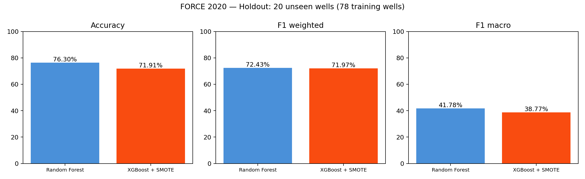
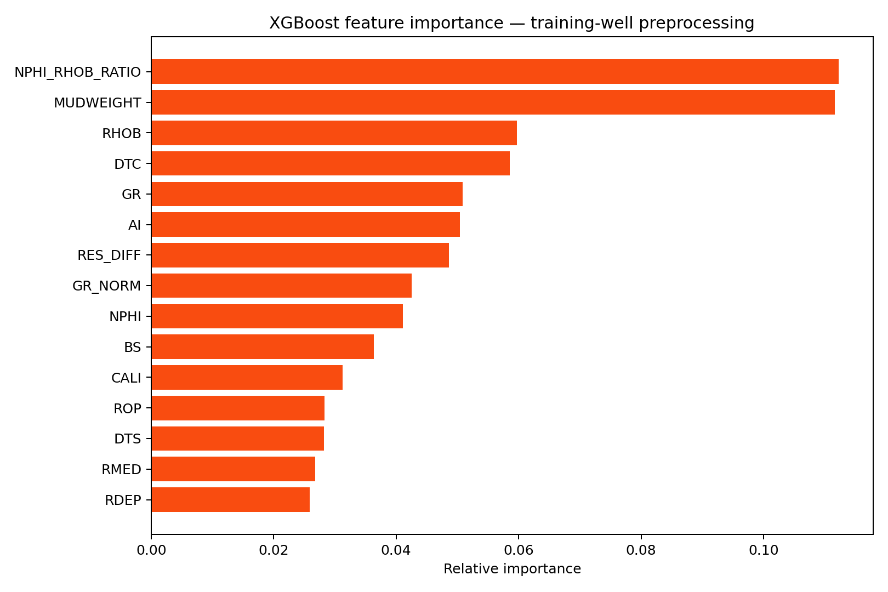

# Well Log Lithology Prediction (FORCE 2020)

Classificação litológica com Random Forest, XGBoost, balanceamento de classes e Streamlit. Python 3.11.

## Estado e migração

O pipeline corrigido e o novo bundle treinado estão incluídos. O treino separa poços e partilha o mesmo pré-processamento com a aplicação. Os três artefactos legados foram substituídos por `models/lithology_bundle.joblib`.

Avaliação com 78 poços de treino e 20 poços de teste, sem sobreposição:

| Pipeline | Accuracy | F1 weighted | F1 macro |
|---|---:|---:|---:|
| Random Forest | 76,30% | 72,43% | 41,78% |
| XGBoost + SMOTE | 71,91% | 71,97% | 38,77% |

O XGBoost continua a ser o modelo de implantação declarado; esta avaliação não demonstra vantagem sobre Random Forest. O F1 macro evidencia limitações nas classes menos representadas. Veja as métricas por classe e os poços em [reports/metrics.json](reports/metrics.json). A escolha de outro modelo ou optimização deve usar validação interna por poço e uma nova avaliação independente.

Os resultados antigos de 94,19% e 88,02% usavam separação aleatória por amostra e pré-processamento anterior ao split, pelo que não são comparáveis a este holdout por poço.




## Dados e execução

1. Obtenha o `train.csv` original no [repositório oficial do desafio FORCE 2020](https://github.com/bolgebrygg/Force-2020-Machine-Learning-competition), respeitando a licença e os termos da fonte. O README da fonte contém as instruções de acesso ao conjunto de treino. Os dados não estão incluídos neste projecto.
2. Coloque o ficheiro, separado por ponto e vírgula, em `data/raw/train.csv`. Deve conter `WELL`, `FORCE_2020_LITHOFACIES_LITHOLOGY` e as curvas necessárias.
3. Execute a partir da raiz:

```bash
python3 -m venv .venv
source .venv/bin/activate
pip install -r requirements.txt
python src/download_data.py  # omita se já colocou train.csv em data/raw/
python src/train.py
# Opcional: preparar a tabela usada pelo Explorador de Dados
python src/preprocess.py
streamlit run app/streamlit_app.py
```

Pode indicar outro conjunto com `python src/train.py --data /caminho/train.csv`. O treino produz `models/lithology_bundle.joblib` e `reports/metrics.json`. A aplicação deve ser reiniciada após substituir o bundle, para limpar o cache do modelo. O Explorador permite carregar um CSV FORCE ou usar a tabela processada local.

## Metodologia

- Holdout por `WELL`, com poços disjuntos e seed fixa. Medianas e limites GR são ajustados exclusivamente no treino.
- Logs ausentes são imputados antes de calcular as sete variáveis derivadas; a mesma transformação é guardada no bundle e usada na aplicação.
- Impedância acústica: `RHOB * (304800 / DTC)`, assumindo RHOB em g/cm³ e DTC em µs/ft. O resultado usa a convenção densidade em g/cm³ e velocidade em m/s; multiplique por 1000 para unidades SI de impedância.
- A API exige as colunas GR, RHOB, NPHI, DTC, RDEP e PEF. Células vazias são imputadas; linhas sem qualquer medição nuclear, texto, infinito e valores não físicos de RHOB/DTC/RDEP são rejeitados. Curvas opcionais totalmente ausentes no treino recebem zero de forma consistente.
- XGBoost usa até 100 mil amostras de treino e SMOTE com vizinhança adaptada. Classes com apenas uma amostra usam sobreamostragem por duplicação. Random Forest usa todo o treino: a comparação mede os pipelines completos, não o efeito isolado de SMOTE.
- O XGBoost é a escolha de implantação declarada antecipadamente. O holdout é usado para relatório, nunca para seleccionar automaticamente o vencedor. Antes de mudar o modelo, use validação por poço dentro do treino.
- O relatório inclui accuracy, F1 weighted, F1 macro, métricas por classe e os poços de cada partição. Classes que só aparecem no teste interrompem o treino com uma mensagem explícita.
- A aplicação mantém as probabilidades originais do modelo. Densidade elevada gera um aviso, sem inventar classes ou confiança de 99%. As probabilidades não estão calibradas como certeza geológica.
- Previsão em lote vectorizada e carregamento do bundle em cache. CSVs com vírgula ou ponto e vírgula; exportação preserva os resultados da última execução.

Este modelo é treinado com dados do Mar da Noruega. A aplicação em Moçambique ou noutras bacias exige validação local; não existem métricas locais neste repositório.

## Verificação

```bash
python -m unittest discover -s tests -v
python -m compileall -q src app
```

O GitHub Actions executa estas verificações. Os testes usam dados sintéticos para validar isolamento por poço, imputação e derivados, entradas inválidas, classes raras, persistência e equivalência entre previsão individual e em lote. Não substituem a avaliação com FORCE.

## Licenciamento

Os termos do dataset pertencem à fonte original. Este repositório ainda não declara uma licença própria para o código; o proprietário deve escolher a licença antes de o distribuir como software licenciado.
